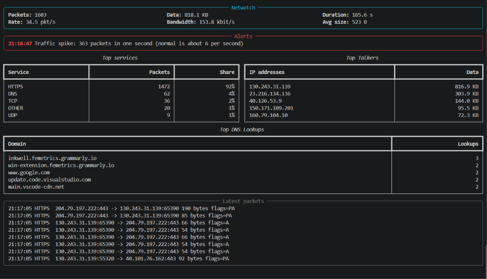
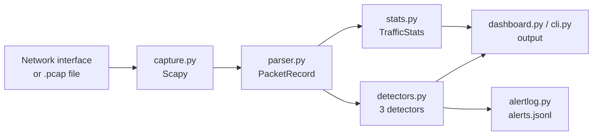

# NetWatch


**NetWatch is a network traffic monitor and anomaly detector written in Python.**
It captures packets live from a network interface or reads them from a `.pcap` file,
shows real-time traffic statistics in a terminal dashboard, and raises alerts for
suspicious activity such as port scans, traffic spikes and suspicious DNS lookups.



## Features

- **Packet capture** – live from a network interface, or offline from `.pcap` files
- **Protocol parsing** – IPv4/IPv6, TCP, UDP, ICMP and DNS, with service names for well-known ports
- **Traffic statistics** – packets per second, bandwidth, top services, top talkers and top DNS lookups, using a sliding time window
- **Live terminal dashboard** – built with [Rich](https://github.com/Textualize/rich), redrawn at a throttled rate so it stays fast under heavy traffic
- **Three detectors**
  - **Port scan** – one host trying many different ports on another host in a short time
  - **Traffic spike** – a second with far more packets than the learned baseline
  - **Suspicious DNS** – very long labels (typical of DNS tunnelling) and random-looking, high-entropy names (typical of malware domain generation algorithms)
- **Alert log** – alerts saved as JSON Lines, ready for tools like Splunk or the ELK stack
- **Tested** – 35 unit tests with pytest, run automatically on Linux and Windows with GitHub Actions

## Quick start

'''bash
docker build -t netwatch .
docker run --rm netwatch
'''

```bash
git clone https://github.com/Sameer003-Imt/netwatch.git
cd netwatch
python -m venv .venv
.venv\Scripts\activate          # Windows
# source .venv/bin/activate     # Linux / macOS
pip install -r requirements.txt
```

Try it safely on the included demo capture (no network access needed):

```bash
python scripts/make_sample_pcap.py
python -m netwatch --pcap samples/demo.pcap --quiet
```

Example output:

```
!! ALERT 23:13:40  SUSPICIOUS_DNS: Suspicious DNS lookup: aGVsbG8gd29ybGQgdGhpcyBpcyBzZWNyZXQgZGF0YQ.tunnel.example (very long part (42 characters))
!! ALERT 23:13:40  SUSPICIOUS_DNS: Suspicious DNS lookup: x7k2p9q4m8z1w5r3t6y0b2.com (random-looking part (entropy 4.4))
!! ALERT 23:13:40  TRAFFIC_SPIKE: Traffic spike: 203 packets in one second (normal is about 5 per second)
!! ALERT 23:13:42  PORT_SCAN: Possible port scan: 192.168.1.66 tried 15 different ports on 192.168.1.10 within 5 s

===== NetWatch summary =====
Packets:          603
Data:             27.2 KB
Duration:         24.4 s
...
Alerts: 4
```

## Usage

```bash
# Live capture, one line per packet (stop with Ctrl+C)
python -m netwatch --live

# Live dashboard
python -m netwatch --live --dashboard

# Analyse a capture file and save alerts to a log
python -m netwatch --pcap capture.pcap --quiet --alert-log alerts.jsonl

# All options
python -m netwatch -h
```

| Option | Description |
|---|---|
| `--live` / `--pcap FILE` | Capture live traffic, or read a `.pcap` file (one is required) |
| `--iface NAME` | Network interface for live capture (default: the system default) |
| `--count N` | Stop after N packets |
| `--quiet` | Only print alerts and the final summary |
| `--dashboard` | Show the live terminal dashboard |
| `--alert-log FILE` | Append alerts to a JSON Lines file |

**Live capture requirements:** on Windows, install [Npcap](https://npcap.com/).
On Linux and macOS, live capture needs root (`sudo`). Reading `.pcap` files needs no special rights.

## How it works



The key design decision is that **only `parser.py` and `capture.py` use Scapy**.
Every packet is turned into a small, immutable `PacketRecord`, and the statistics,
detectors and dashboard only work with those records. This keeps each part simple,
makes it possible to test the logic with hand-made records instead of real traffic,
and means the capture library could be replaced without touching the rest.

All detectors share the same interface, `check(record) -> Alert | None`, so adding a
new detector only means adding it to the list in `cli.py`.

## Detection logic

| Detector | Rule (default settings) | Known limitations |
|---|---|---|
| **Port scan** | One source sends TCP SYNs to **≥ 15 different ports** on one target within **5 s**. A 60 s cooldown prevents repeated alerts. | Slow scans (e.g. one port per second) and scans spread over many source IPs are not detected. |
| **Traffic spike** | A second with more than **5× the average** of the last 30 seconds, and at least **100 packets**. Needs 10 s of history first. | Gradual increases are not flagged; a long attack slowly becomes the new "normal". |
| **Suspicious DNS** | A domain label longer than **40 characters**, or a label of ≥ 20 characters with **Shannon entropy ≥ 4.0**. Each domain is reported once. | Some legitimate CDN or tracking domains can look random; short random names are not flagged. |

Service names (HTTPS, DNS, …) are based on **port numbers only**, so traffic on a
non-standard port is not recognised. Real intrusion detection systems use deep packet
inspection to identify protocols by their content.

## Alert log format

Each line in the alert log is one JSON object:

```json
{"timestamp": 1700000020.0, "kind": "TRAFFIC_SPIKE", "source_ip": "*", "target_ip": "*", "message": "Traffic spike: 203 packets in one second (normal is about 5 per second)", "time": "2023-11-14T22:13:40+00:00"}
```

## Project structure

```
netwatch/
├── netwatch/
│   ├── capture.py      # read packets from a file or a network interface
│   ├── parser.py       # turn Scapy packets into PacketRecords
│   ├── stats.py        # traffic statistics with a sliding window
│   ├── detectors.py    # port scan, traffic spike and suspicious DNS detectors
│   ├── alertlog.py     # save alerts as JSON Lines
│   ├── dashboard.py    # live terminal dashboard (Rich)
│   ├── formatting.py   # helpers for readable numbers and times
│   └── cli.py          # command-line interface
├── tests/              # pytest tests
├── scripts/            # make_sample_pcap.py: builds the safe demo capture
└── samples/            # demo.pcap
```

## Running the tests

```bash
python -m pytest -v
```

The tests build packets in memory with Scapy or use hand-made `PacketRecord`s,
so they need no network access and no special rights.

## Responsible use

Only capture traffic on networks and devices you own or have permission to monitor.
The demo capture in `samples/` is generated entirely in memory, so you can test every
detector without sending a single packet.

## Possible next steps

- Export metrics to Prometheus and show them in Grafana
- A web dashboard
- A Docker image
- More detectors, e.g. SYN floods or connections to known-bad IP addresses

## License

MIT – see [LICENSE](LICENSE).
